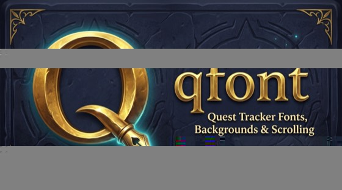

# qfont — Quest Tracker Fonts, Backgrounds & Scrolling

Make your quest tracker effortless to read without replacing your UI.

**qfont** is a lightweight, zero-dependency addon for **World of Warcraft: Forever (1.60.1)** and **Retail Midnight (12.1.5+)** that lets you customize your Quest / Objective Tracker's **font family**, **font sizes**, **textured backgrounds**, **borders**, and **overflow scroll bar** with instant live preview.

Works automatically with both **Questie Tracker** and **Blizzard's default Objective Tracker**.

---

## Key Features

### Crisp, Readable Typography
- **Independent Font Sizes (8–32 px):** Resize **Section Headers**, **Quest Titles**, and **Objective Lines** separately, or scale all three together with a single command.
- **Built-in & Custom Fonts:** Includes *Friz Quadrata*, *Arial Narrow*, *Morpheus*, *Skurri*, and *Friends*, plus automatic detection of any extra fonts registered in **LibSharedMedia-3.0**.
- **Outlines & Drop Shadows:** Choose from *None*, *Outline*, *Thick Outline*, *Monochrome*, or *Outline + Monochrome*, paired with a toggleable drop shadow for clarity over bright terrain.

### Textured Backgrounds & Borders
- **7 Built-in Background Textures:** *Dialog Dark*, *Solid Flat*, *Tooltip*, *Dialog Classic*, *Parchment (Quest Scroll)*, *Marble*, and *Carved Rock*—plus automatic **LibSharedMedia-3.0** background support.
- **6 Built-in Borders:** *Tooltip*, *None (Borderless)*, *Thin 1px Flat*, *Dialog*, *Gold*, and *Achievement Wood*—plus **LibSharedMedia-3.0** borders.
- **Full Styling Controls:** 7 color tint presets (*Obsidian Dark*, *Natural / Untinted*, *Midnight Indigo*, *Warm Parchment*, *Emerald Dusk*, *Crimson Ember*, *Cool Slate*), opacity (`0–100%`), padding (`0–24 px`), and automatic tight fit around tracked quests.

### Auto-Showing Overflow Scroll Bar
- **Max Quest Window Height (20–90%):** Keep long quest lists from overlapping your action bars.
- **Smart Scroll Bar:** Stays hidden when all quests fit and automatically appears along the right edge whenever quests overflow—supporting thumb dragging, track clicks, and mouse-wheel scrolling.

---

## Installation

- **CurseForge App (Recommended):** Search for **qfont** and click Install.
- **Manual:** Download the latest `qfont-*.zip` from [Releases](https://github.com/michaelbaker-dev/qfont/releases) and extract the `qfont` folder into your World of Warcraft `Interface/AddOns/` directory (`_forever_/Interface/AddOns/qfont` or `_retail_/Interface/AddOns/qfont`).

---

## How to Configure

- **Live Preview Window:** Type `/qfont` (or `/qf`) to open a compact, draggable config window with **Fonts & Sizes** and **Background & Scroll** tabs while watching your quest tracker update live.
- **Blizzard Settings Menu:** Open **Esc → Options → AddOns → qfont** (or type `/qfont options`).
- **Minimap Addon Compartment:** **Left-Click** for the live window, **Right-Click** for Blizzard Options.

---

## Slash Commands

### Panels & General
- `/qfont` or `/qf` — Toggle the live config window
- `/qfont options` — Open **Options → AddOns → qfont**
- `/qfont toggle` — Temporarily disable or re-enable custom quest fonts
- `/qfont reset` — Restore all settings and tracker defaults

### Fonts & Sizes
- `/qfont font <name>` — Switch font family (e.g. `/qfont font arial`, `/qfont font morpheus`)
- `/qfont list` — List all available fonts
- `/qfont size <n>` — Set objective size and auto-scale titles (`+2`) and headers (`+4`)
- `/qfont header <n>` · `/qfont title <n>` · `/qfont body <n>` — Set individual sizes (`8–32`)
- `/qfont outline <none|outline|thick|mono|both>` — Change outline style
- `/qfont shadow <on|off>` — Toggle text drop shadow

### Backgrounds & Scrolling
- `/qfont bg [on|off|<texture>]` — Toggle background or switch texture (e.g. `/qfont bg parchment`, `/qfont bg marble`)
- `/qfont bglist` — List all available background & border textures
- `/qfont border <name>` — Set border (`tooltip`, `none`, `pixel`, `dialog`, `gold`, `wood`)
- `/qfont tint <name>` — Set color tint (`obsidian`, `natural`, `midnight`, `parchment`, `forest`, `crimson`, `slate`)
- `/qfont alpha <0-100>` — Set background opacity percentage
- `/qfont padding <0-24>` — Set background padding in pixels
- `/qfont scroll <on|off>` — Toggle the overflow scroll bar
- `/qfont height <20-90>` — Set max quest window height (% of screen) before scrolling

---

## Frequently Asked Questions

**Does qfont work with Questie?**  
Yes. When Questie's tracker is active, qfont automatically styles Questie's fonts, line spacing, background texture, border, and overflow scroll bar—and restores Questie's original settings if disabled.

**How do I add more fonts or textures?**  
Install any **LibSharedMedia-3.0** pack (such as *SharedMedia*) and qfont will automatically list all added fonts, backgrounds, and borders.

**Does qfont cause UI taint or combat errors?**  
No. qfont uses only secure post-hooks (`hooksecurefunc`), never attaches custom fields to Blizzard frames, and defers layout updates cleanly until you leave combat.
